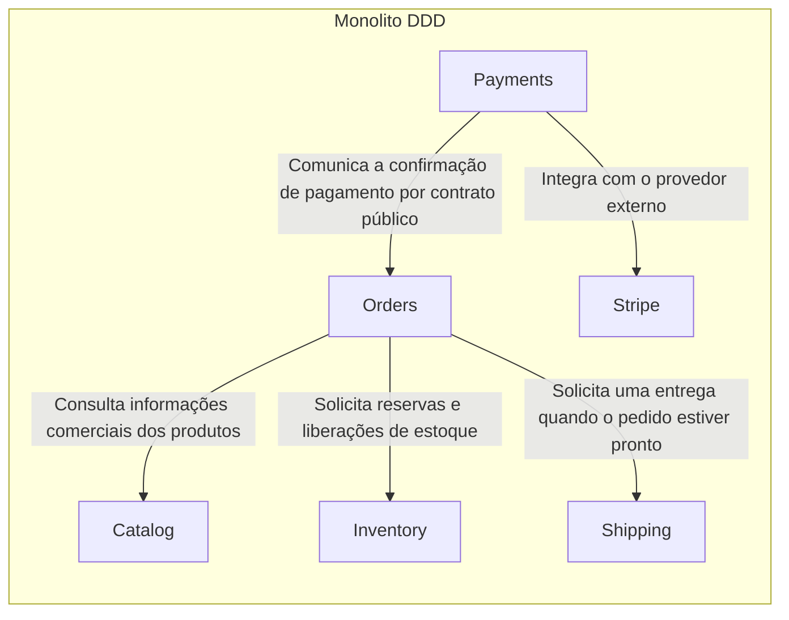

Criar docs/architecture/README.md com visão geral, limites e dependências entre módulos

# Visao Geral

Sistema de ecommerce de cafe, com catalogo, invetorio, sistema de ordens, integracao com provedores de pagamento e sistema entrega com calculo de frete.
O cliente vai poder ver a lista de cafes, adicionar no carrinho, analisar a escolha e adicionar dados de endereco, criar a ordem, solicitar o pagamento, realizar o pagamento e aguardar a entrega do pedido.
O projeto vai ser iniciado como um monolito com arquitetura DDD e responsabilidade separada de cada modulo visando uma possivel migracao para microservicos no futuro.

## Tecnologias

- NestJS
- PostgreSQL
- Docker
- Stripe
- Node Testing
- Pnpm
- CI/CD

## Modulos

- Catalog
Cadastro, Descricao, preco, disponibilidade comercial dos cafes.
Responsavel por apresentar e organizar os produtos.

- Inventory
Quantidade disponivel e movimentacoes de estoque.
Responsavel por controlar a disponibilidade fisica dos produtos.
Responsavel por reservas, liberacao e movimentacoes de estoque. 

- Orders
Criacao, itens, valores registrados e status de pedidos.
Coordena o ciclo de vida do pedido e registra os valores dos produtos no momento da compra.

- Payments
Cobrancas, pagamentos e confirmacoes.
Responsavel por registrar o pagamentos, gerencia cobrancas, estados de pagamentos e integracao com provedores externos.

- Shipping
Enderecos de entega, calculo de frete e acompanhamento.
Responsavel por registrar as entregas, apos o pedido estiver pronto para entrega.

## Dependencias

- Inventory
Pode consultar o Catalog apenas para informacoes basicas.
Controla reservas e movimentações, sem permitir alterações diretas de outros módulos

- Orders
Pode consultar informacoes de produtos do Catalog para verificar se o cafe existe e depois o Invetory para verificar se existe a quantidade disponivel, mas nao devera acessar diretamente os detalhes internos de persistencia do Catalog nem Invetory.
É o único responsável por validar e modificar o estado dos pedidos

- Payments
Pode consultar o Orders.
Confirma pagamentos e solicita a atualização de Orders por um contrato público.

- Shipping
Pode se comunicar com o Orders para saber se o pedido foi concluido.
Gerencia entregas quando solicitado por Orders

## Diagrama dependencia

## Diagrama arquitetura geral

## Banco de dados

Vamos utilizar o PosgreSQL, um banco SQL porque vou poder ter relacoes entre os registro.
O que vai facilitar para verificar quais produtos estao numa ordem, qual ordem emitiu o pagamento.
Vou poder melhorar as consultas com indexacao, vou poder utilizar transactions para persistir dados importantes.
